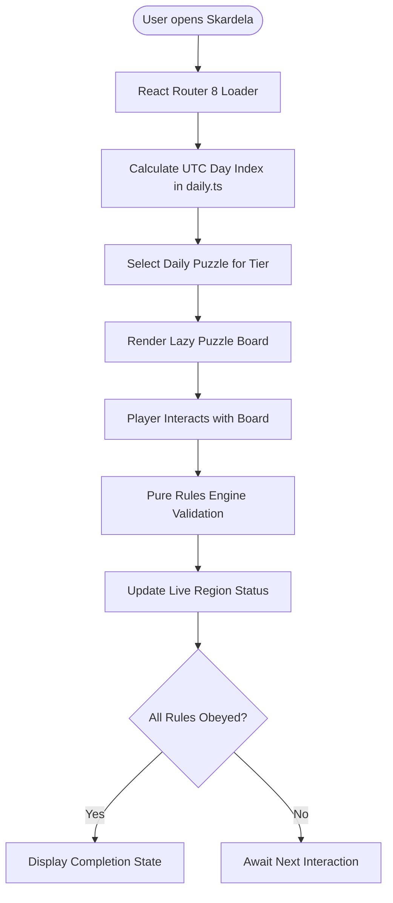

# Skardela: Project Description

## 1. Executive Summary

**Skardela** is a client-side daily puzzle web application. It delivers free daily puzzles directly in modern web browsers.

### Key Objectives

- **Zero Friction:** The application requires no user accounts, no login walls, no app installations, and no tracking cookies.
- **Pure Client-Side Architecture:** The application runs completely in the browser. It does not use a backend server, database, or external API.
- **Accessible by Design:** The interface complies with WCAG 2.1 AA accessibility guidelines. It provides full keyboard navigation, screen reader support, high-contrast themes, and dual visual indicators (colors paired with shapes and symbols).
- **Deterministic Daily Rotation:** The application selects puzzles deterministically based on UTC calendar dates. Every player in the world receives the exact same puzzle on any given day.

---

## 2. System Architecture & Stack

### Core Framework and Runtime

- **Runtime Environment:** Node.js 24 (`.nvmrc`), npm 11.
- **Language:** TypeScript 6 configured with strict type checking (`strict`, `erasableSyntaxOnly`, `verbatimModuleSyntax`).
- **UI Library:** React 19 (`react`, `react-dom`) with React Compiler integration (`babel-plugin-react-compiler`, `@rolldown/plugin-babel`).
- **Routing Engine:** React Router 8 (`react-router`) with route loaders (`homeLoader`, `puzzleLoader`), error boundaries, and code-split lazy puzzle boards.

### Styling & Design System

- **CSS Architecture:** Pure CSS Modules with scoped styles for layouts and components.
- **Theming:** Dual-theme system (`light`, `dark`, and `system`) using modern CSS `light-dark()` color tokens.
- **FOUC Prevention:** Synchronous inline `<script>` in `index.html` initializes the user's stored theme before initial paint.
- **Fluid Layout:** Fluid typography and spacing using CSS `clamp()` and container query font sizing (`cqi`).

### Quality Assurance & Tooling

- **Build Tool:** Vite 8 (`vite`, `@vitejs/plugin-react`).
- **Linter & Formatter:** Oxlint 1.86 and Oxfmt 0.71 for high-speed static analysis and formatting.
- **Test Framework:** Vitest 5 configured with two projects:
  - `unit`: Component and logic unit tests executed in `jsdom`.
  - `validate`: Pre-deployment JSON puzzle dataset integrity tests executed in `node`.
- **Client Observability:** `@utk09/ui-observability` configured for console logging without network telemetry.
- **CI/CD Pipeline:** GitHub Actions workflow (`.github/workflows/deploy-netlify.yml`) validating code quality and deploying to Netlify production.
- **Hosting Platform:** Netlify static hosting configured via `netlify.toml` with SPA routing rewrites (`/* -> /index.html` 200).

---

## 3. Core Workflows & Features

### 1. Deterministic Daily Puzzle Rotation (`src/app/daily.ts`)

- Calculates a stable day index by measuring days elapsed since a fixed UTC epoch (`2024-01-01`).
- Deterministically selects a puzzle for each difficulty tier (`easy`, `medium`, `hard`) from the puzzle pool using modulo arithmetic.
- Ensures all players receive identical daily puzzles regardless of geographical location or local timezone.

### 2. Puzzle Type: Colour Binary (`src/app/puzzle-types/colour-binary/`)

- A grid logic puzzle where players assign red (`●`) or blue (`■`) tokens to cells.
- **Rules:**
  1. Each row and each column must have an equal count of red and blue tokens.
  2. No three consecutive identical tokens are allowed in any row or column.
  3. All rows and columns must be unique.
- **Deductive Hint Engine:** Analyzes current grid states and provides step-by-step deductive hints (e.g., explaining why a cell must be a specific color based on row balance or three-in-a-row exclusions).
- **Backtracking Solver:** Ensures every published puzzle has exactly one valid solution.

### 3. Puzzle Type: Guzzle (`src/app/puzzle-types/guzzle/`)

- A word-intersection puzzle where four words cross at a shared center letter (horizontal, vertical, and two diagonals).
- **Rules:**
  1. Four words share the same length and intersect at the center.
  2. Diagonal words read from left to right.
  3. Letter feedback indicates:
     - **Green (`✓`):** Letter is in the correct position.
     - **Yellow (`↔`):** Letter belongs to the word but in a different position.
     - **Red (`✗`):** Letter does not belong to the word.
- **Play Modes:** Supports playing with a dynamic letter bank (showing remaining letters) or without a letter bank (full alphabet).
- **Mistake Tracking:** Tracks and announces total mistakes made during gameplay.

### 4. Accessibility & UI Compliance

- **Dual Visual Encoding:** Colors are paired with distinctive symbols (`●`, `■`, `✓`, `↔`, `✗`), ensuring accessibility for color-blind players.
- **Screen Reader Announcements:** Dynamic gameplay feedback is provided through accessible `<output>` elements.
- **Accessible Landmarks:** Includes skip-to-content links (`#main`), descriptive navigation labels, and structured heading hierarchies.
- **Touch Target Sizing:** Interactive buttons and puzzle squares meet the 44x44px minimum touch target size.

---

## 4. Deployment Readiness State

| Component          | Target Requirement                     | Current State                             | Verification Status                                       |
| ------------------ | -------------------------------------- | ----------------------------------------- | --------------------------------------------------------- |
| **Build Status**   | `npm run build`                        | Optimized static bundle in `dist/`        | Verified (~363 kB raw / ~116 kB gzip)                     |
| **Type Checking**  | `tsc -b`                               | 0 errors across composite projects        | Verified                                                  |
| **Linting**        | `oxlint --deny-warnings`               | 0 warnings, 0 errors                      | Verified                                                  |
| **Formatting**     | `oxfmt --check`                        | 0 formatting discrepancies                | Verified                                                  |
| **Unit Tests**     | `vitest run --project unit`            | 11 test suites, 45 tests passing          | Verified                                                  |
| **Data Integrity** | `vitest run tools`                     | All JSON puzzles verified                 | Verified (Unique IDs, CC-BY-4.0 license, single solution) |
| **Hosting Config** | `netlify.toml`                         | Build command, Node 24, SPA rewrite rule  | Configured                                                |
| **CI/CD Pipeline** | `.github/workflows/deploy-netlify.yml` | Automated test gate and production deploy | Configured                                                |

### Deployment Prerequisites & Environment Variables

- **Node.js Requirement:** Node `^24.0.0` and npm `^11.0.0`.
- **Runtime Environment Variables:** None. The application operates without backend servers, databases, or runtime environment variables.
- **CI/CD GitHub Secrets (Required for Netlify deployment):**
  - `NETLIFY_AUTH_TOKEN`: Netlify Personal Access Token for API deployment.
  - `NETLIFY_SITE_ID`: Target Netlify Site API ID.
